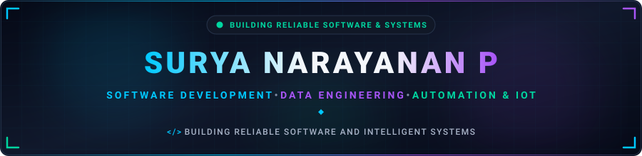

  

  

  
  &nbsp;
  
  &nbsp;
  
  &nbsp;
  

  

---

<h2 align="center">Professional Overview</h2>

  <b>&ldquo;Driven by problem-solving. Building for impact. Automating the future.&rdquo;</b>

  

  Hey! I'm <b>Surya Narayanan P</b>, an <b>Electronics &amp; Communication Engineering student and Software Developer</b> based in Chennai, India. 
  I have hands-on project experience in Python programming, robust backend development (FastAPI/Node.js), real-time streaming architectures (Apache Kafka, PySpark), and Industrial IoT automation platforms. Proficient in Python, Java, SQL, and Linux, with a strong foundation in programming fundamentals, debugging, testing, and database architecture, with a keen interest in RPA and enterprise automation.

  
  &nbsp;
  
  &nbsp;
  
  &nbsp;
  

  💬 <b>Let's Discuss:</b> Python, FastAPI, Java, SQL, PySpark, Kafka, Docker, Industrial IoT &amp; Process Automation. 
  ⚡ <b>Philosophy:</b> <i>"Turning complex real-world data and workflows into reliable, scalable software solutions."</i>

<table width="100%" border="0" align="center">
<tr>
<td width="50%" align="center" style="padding: 14px;">
  <h4>🔭 Flagship Project</h4>
  
<b>ForgePulse</b> Industrial IoT &amp; Digital Twin Platform

</td>
<td width="50%" align="center" style="padding: 14px;">
  <h4>🌱 Active Deep Dives</h4>
  
<b>PySpark &amp; Kafka Streaming</b> Enterprise Automation &amp; RPA Workflows

</td>
</tr>
<tr>
<td width="50%" align="center" style="padding: 14px;">
  <h4>🌐 Portfolio Platform</h4>
  
<a href="https://surya-narayanan-portfolio.onrender.com/" target="_blank"><b>surya-narayanan-portfolio</b></a> Interactive Architecture &amp; Live Demos

</td>
<td width="50%" align="center" style="padding: 14px;">
  <h4>🤝 Collaboration</h4>
  
<b>Backend, Data &amp; IoT</b> Open to engineering roles &amp; technical initiatives

</td>
</tr>
</table>

---

<h2 align="center">Selected Engineering Projects</h2>

<table width="100%" border="0" align="center">
<tr>
<td align="left" style="padding: 22px;">
  <h3>🏭 ForgePulse – Industrial IoT &amp; Digital Twin Platform</h3>
  
<i>A Python-based industrial monitoring and digital twin platform built with FastAPI and MQTT to automate machine telemetry collection and monitor temperature, vibration, RPM, power, and operational status in real-time.</i>

  <ul>
    <li>Implemented telemetry streaming, automated fault injection, and anomaly detection using statistical thresholds, <b>Z-Score</b>, and <b>Isolation Forest</b>.</li>
    <li>Engineered operational monitoring dashboards and automated alert dispatch systems for mission-critical visibility and system diagnostics.</li>
  </ul>
  
<b>Tech Stack:</b> Python, FastAPI, MQTT, PostgreSQL, React, Docker

  

    
    &nbsp;
    
  

</td>
</tr>
<tr>
<td align="left" style="padding: 22px;">
  <h3>💳 Intelligent Transaction Monitoring &amp; Fraud Detection System</h3>
  
<i>A real-time big data processing pipeline for financial fraud detection and streaming transaction analytics.</i>

  <ul>
    <li>Engineered a high-throughput streaming ingestion, transformation, and validation pipeline with <b>Python</b>, <b>Apache Kafka</b>, and <b>PySpark Structured Streaming</b>.</li>
    <li>Implemented a <b>Random Forest</b> fraud classification workflow coupled with an interactive <b>Streamlit</b> analytical monitoring dashboard.</li>
  </ul>
  
<b>Tech Stack:</b> Python, Apache Kafka, PySpark, Machine Learning, Streamlit

</td>
</tr>
<tr>
<td align="left" style="padding: 22px;">
  <h3>🏋️ Full-Stack Gym Management Web Application with AI Assistant</h3>
  
<i>A database-driven full-stack enterprise portal equipped with an integrated local LLM assistant.</i>

  <ul>
    <li>Engineered member lifecycle management, attendance tracking, payment verification, and automated billing notifications.</li>
    <li>Integrated an intelligent AI assistant powered by <b>Ollama (Gemma)</b> with verified REST API endpoints and MySQL relational database workflows.</li>
  </ul>
  
<b>Tech Stack:</b> React, Node.js, REST APIs, MySQL, Ollama (Gemma)

</td>
</tr>
<tr>
<td align="left" style="padding: 22px;">
  <h3>🛡️ IoT-Based Smart Safety Helmet</h3>
  
<i>An intelligent embedded IoT safety system engineered for real-time rider protection and hazard mitigation.</i>

  <ul>
    <li>Incorporates helmet-wear detection, alcohol sensing, drowsiness monitoring, emergency alerts, and anti-theft functionality.</li>
    <li>Interfaced multi-sensor modules with an <b>ESP32 microcontroller</b> and implemented low-latency firmware control logic for instant automated alert dispatch.</li>
  </ul>
  
<b>Tech Stack:</b> ESP32, Embedded Systems, IoT, C/C++, Sensors

</td>
</tr>
</table>

---

<h2 align="center">Technical Expertise &amp; Engineering Stack</h2>

<b>Core Programming Languages</b>

  

<b>Backend, APIs &amp; Architectures</b>

  

<b>Data Engineering, Big Data &amp; Analytics</b>

  
  &nbsp;
  
  &nbsp;
  
  &nbsp;
  
  &nbsp;
  
  &nbsp;
  

<b>Databases &amp; Storage</b>

  

<b>Industrial IoT &amp; Embedded Systems</b>

  
  &nbsp;
  
  &nbsp;
  
  &nbsp;
  

<b>Development, DevOps &amp; Platforms</b>

  

---

<h2 align="center">Development Metrics &amp; GitHub Activity</h2>

  
  &nbsp;&nbsp;
  

  

  

---

<h2 align="center">Open-Source Contribution History</h2>

  

---

<h2 align="center">Connect &amp; Professional Collaboration</h2>

<i>Whether you want to discuss backend architecture, process automation, or open-source projects — my inbox is always open!</i>

<table border="0" align="center">
<tr>
<td align="center" width="240" style="padding: 16px;">
  <a href="https://www.linkedin.com/in/suryanarayanan-p1305/" target="_blank">
    
      
    
  </a>
   
  <b>Professional Network</b>
</td>
<td align="center" width="240" style="padding: 16px;">
  <a href="https://surya-narayanan-portfolio.onrender.com/" target="_blank">
    
      
    
  </a>
   
  <b>Live Portfolio &amp; Projects</b>
</td>
<td align="center" width="240" style="padding: 16px;">
  <a href="mailto:suryanarayanan1305@gmail.com">
    
      
    
  </a>
   
  <b>Direct Communication</b>
</td>
</tr>
</table>

  

