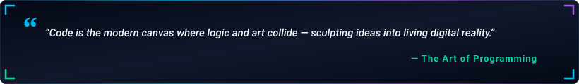

  

  

  
  &nbsp;
  
  &nbsp;
  
  &nbsp;
  

  

---

<h2 align="center">🔴 About Me</h2>

  

  

  Hey! I'm <b>Surya Narayanan P</b>, a passionate <b>Electronics and Communication Engineering student &amp; Software Developer</b> based in Chennai, India. 
  I have hands-on project experience in Python programming, backend development, process automation, and real-time application monitoring. Proficient in Python, Java, SQL, FastAPI, and Linux, with a strong foundation in programming fundamentals, debugging, testing, and database management, with a keen interest in RPA and enterprise automation.

  
  &nbsp;
  
  &nbsp;
  
  &nbsp;
  

  💬 <b>Let's Discuss:</b> Python, FastAPI, Java, SQL, PySpark, Kafka, Docker, Industrial IoT &amp; Process Automation. 
  ⚡ <b>Philosophy:</b> <i>"Turning complex real-world data and workflows into reliable, scalable software solutions!"</i>

<table width="100%" border="0" align="center">
<tr>
<td width="50%" align="center" style="padding: 14px;">
  <h4>🔭 Flagship Project</h4>
  
<b>ForgePulse</b> Industrial IoT &amp; Automation Platform

</td>
<td width="50%" align="center" style="padding: 14px;">
  <h4>🌱 Active Deep Dives</h4>
  
<b>PySpark &amp; Kafka Streaming</b> Enterprise Automation &amp; RPA Workflows

</td>
</tr>
<tr>
<td width="50%" align="center" style="padding: 14px;">
  <h4>🌐 Portfolio Website</h4>
  
<a href="https://surya-narayanan-portfolio.onrender.com/" target="_blank"><b>surya-narayanan-portfolio</b></a> Live Projects &amp; Interactive Demos

</td>
<td width="50%" align="center" style="padding: 14px;">
  <h4>🤝 Collaboration</h4>
  
<b>Backend, Data &amp; IoT</b> Open to developer roles &amp; tech initiatives

</td>
</tr>
</table>

---

<h2 align="center">🚀 Featured Projects Spotlight</h2>

<table width="100%" border="0" align="center">
<tr>
<td align="left" style="padding: 22px;">
  <h3>🏭 ForgePulse – Industrial IoT &amp; Automation Platform</h3>
  
<i>A Python-based industrial monitoring platform built with FastAPI and MQTT to automate machine telemetry collection and monitor temperature, vibration, RPM, power, and machine status in real-time.</i>

  <ul>
    <li>Implemented telemetry processing, fault injection, and anomaly detection using statistical thresholds, <b>Z-Score</b>, and <b>Isolation Forest</b>.</li>
    <li>Created monitoring dashboards and automated alert generation for end-to-end operational visibility and troubleshooting.</li>
  </ul>
  
<b>Tech Stack:</b> Python, FastAPI, MQTT, PostgreSQL, React, Docker

  

    
    &nbsp;
    
  

</td>
</tr>
<tr>
<td align="left" style="padding: 22px;">
  <h3>💳 Intelligent Transaction Monitoring &amp; Fraud Detection System</h3>
  
<i>A real-time big data processing pipeline for financial fraud detection and streaming transaction analytics.</i>

  <ul>
    <li>Engineered a streaming ingestion, transformation, and validation pipeline with <b>Python</b>, <b>Apache Kafka</b>, and <b>PySpark Structured Streaming</b>.</li>
    <li>Implemented a <b>Random Forest</b> fraud classification workflow coupled with an interactive <b>Streamlit</b> monitoring dashboard.</li>
  </ul>
  
<b>Tech Stack:</b> Python, Apache Kafka, PySpark, Machine Learning, Streamlit

</td>
</tr>
<tr>
<td align="left" style="padding: 22px;">
  <h3>🏋️ Full-Stack Gym Management Web Application with AI Assistant</h3>
  
<i>A database-driven full-stack management portal equipped with an integrated local LLM assistant.</i>

  <ul>
    <li>Engineered member records management, attendance logging, payment tracking, and automated fee reminder notifications.</li>
    <li>Integrated an intelligent AI assistant powered by <b>Ollama (Gemma)</b> with validated REST API and MySQL database workflows.</li>
  </ul>
  
<b>Tech Stack:</b> React, Node.js, REST APIs, MySQL, Ollama (Gemma)

</td>
</tr>
<tr>
<td align="left" style="padding: 22px;">
  <h3>🛡️ IoT-Based Smart Safety Helmet</h3>
  
<i>An intelligent embedded IoT safety system engineered for real-time rider protection and hazard prevention.</i>

  <ul>
    <li>Features helmet-wear detection, alcohol sensing, drowsiness monitoring, emergency alerts, and anti-theft functionality.</li>
    <li>Interfaced multi-sensor modules with an <b>ESP32 microcontroller</b> and implemented firmware control logic for instant automated alert dispatch.</li>
  </ul>
  
<b>Tech Stack:</b> ESP32, Embedded Systems, IoT, C/C++, Sensors

</td>
</tr>
</table>

---

<h2 align="center">🛠️ Tech Stack &amp; Skills</h2>

<b>Core Programming Languages</b>

  

<b>Frontend &amp; UI Development</b>

  

<b>Backend, APIs &amp; Frameworks</b>

  

<b>Databases, Big Data &amp; Analytics</b>

  

  
  &nbsp;
  
  &nbsp;
  
  &nbsp;
  
  &nbsp;
  

<b>Tools, DevOps &amp; Platforms</b>

  

---

<h2 align="center">📊 GitHub Analytics &amp; Activity</h2>

  
  &nbsp;&nbsp;
  

  

  

---

<h2 align="center">⚡ Contribution Journey</h2>

  

---

<h2 align="center">📬 Let's Connect &amp; Collaborate</h2>

<i>Whether you want to discuss backend architecture, process automation, or open-source projects — my inbox is always open!</i>

<table border="0" align="center">
<tr>
<td align="center" width="240" style="padding: 16px;">
  <a href="https://www.linkedin.com/in/suryanarayanan-p1305/" target="_blank">
    
      
    
  </a>
   
  <b>Professional Network</b>
</td>
<td align="center" width="240" style="padding: 16px;">
  <a href="https://surya-narayanan-portfolio.onrender.com/" target="_blank">
    
      
    
  </a>
   
  <b>Live Portfolio &amp; Projects</b>
</td>
<td align="center" width="240" style="padding: 16px;">
  <a href="mailto:suryanarayanan1305@gmail.com">
    
      
    
  </a>
   
  <b>Direct Communication</b>
</td>
</tr>
</table>

  

